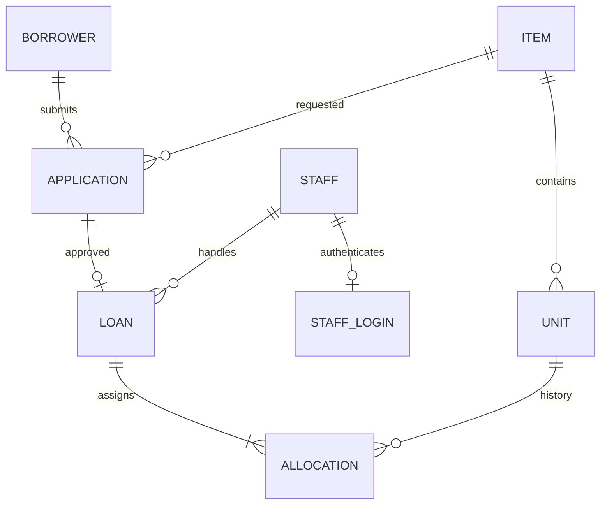

# 빌려드립니다 발표 시연

## 6분 진행표

| 시간 | 화면에서 보여줄 동작 | 설명할 내용 |
|---|---|---|
| 0:00–0:40 | 휴대폰 홈 → 물품 상세 | 기존 Forms 접수와 수기 대장을 하나의 DB로 통합했습니다. |
| 0:40–1:30 | 글러브 신청 → 학부·학과 선택 → 기한 확인 | 이 단계에서는 재고가 그대로입니다. 승인할 때 담당자가 실제 전달 수량을 정합니다. |
| 1:30–2:20 | PC 신청 목록 → 글러브 3개·담당 임원·야구공 1개 비고 → 보증금·신분증 수령 → 승인 | PC 목록 자동 갱신과 휴대폰 가용 수량 감소를 함께 보여줍니다. |
| 2:20–3:00 | 대여·반납 → 수령했던 보증금·신분증 반환 확인 → 반납 | 수령했던 항목은 반환을 확인해야 반납할 수 있습니다. |
| 3:00–4:00 | demo 학번 20990001의 기한 경과 건 반납 → 신청 차단 → 제한 해제 | 지각 세 번째에 자동 정지되며 해제 후에도 이력이 보존됩니다. |
| 4:00–4:45 | 운영 설정에서 오늘을 포함한 중단 기간 추가 → 학생 운영 안내 → 중단 해제 | 학생 API가 운영 조건을 서버에서 다시 검사합니다. |
| 4:45–5:30 | 월별 시트와 오늘의 전화 화면 → 본인 동의가 있는 시연 번호로 전화 링크 탭 | 서울 날짜로 월 탭과 일자를 선택합니다. 실기기 전화 화면에서 확인 후 취소할 수 있습니다. |
| 5:30–6:00 | 이용 통계 → 기간 필터 → 작업 이력 | 실제 승인 건을 기준으로 그래프와 처리자를 보여줍니다. |

발표 전에 demo 프로필로 실행하고 폰과 노트북을 같은 네트워크에 연결합니다. 오늘 당직자의 연락처는 관리자에서 입력합니다. 당일 배정이 없는 날은 빈 상태가 정상입니다.

## 데이터베이스 관계

- **application**은 학생이 제출한 당시의 이름·소속·연락처와 고정된 품목을 보존합니다. 재시도 토큰의 UNIQUE 키로 같은 제출을 한 번만 접수합니다.
- **loan**은 신청당 최대 한 건입니다. 승인 시각, 확정 기한, 수령 여부, 실제 반납, 지각 판정, 보증금·신분증 반환을 기록합니다. 이력에서 반납 판정을 정정할 수 있습니다.
- **allocation**은 대여 건과 고유번호의 다대다 이력을 연결합니다. 실물 야구공과 셔틀콕 수량은 loan의 비고를 사용합니다.
- **borrower**는 학번별 누적 지각과 현재 정지 여부를 분리합니다. 관리자 정지·해제와 정정 사유는 audit에 남습니다.
- **policy / closure**는 정기 시간과 별도 중단 기간을 관리합니다. 모든 업무 시각은 Asia/Seoul 기준입니다.
- **staff / staff_login**은 당직자 연락처·담당 임원과 해시 처리된 개인 로그인 정보를 관리합니다. 전화번호는 공개 달력에서 읽지 않습니다.
- **audit**에는 변경 시각, 로그인 계정, 작업 내용이 남습니다. 최근 200건을 관리자 화면에서 볼 수 있습니다.

## 동시 승인 질문에 답하기

두 관리자가 같은 번호를 보고 있더라도 승인 API는 트랜잭션 안에서 먼저 운영 설정 한 행의 쓰기 잠금을 획득합니다. 이 로컬 단일 창구에서는 쓰기 작업을 짧게 직렬화하는 방식으로 재고·학번·신청·운영 설정을 일관되게 검사합니다. 고유번호 갱신에는 품목과 현재 상태 조건도 들어갑니다. 세 번호 중 하나라도 이미 대여됐다면 방금 만든 대여 기록과 먼저 바꾼 번호를 함께 롤백합니다. 조회 화면의 자동 갱신은 편의 기능이고 무결성은 DB 트랜잭션으로 보장합니다. 외부 시트 요청은 이 잠금을 잡지 않습니다.

반납은 한 트랜잭션에서 실물 전체를 가용 상태로 복구하고 지각을 한 번만 누적합니다. 예외 대여 시에는 미제출 항목과 사유를 기록합니다. 해제 직후에는 기존 지각 횟수만으로 다시 정지되지 않으며 다음 지각에서 제한을 다시 판정합니다.

## 현장 확인

1. 운영시간에 정상 신청하고 관리자 목록 자동 갱신을 확인합니다.
2. 브라우저 두 개에서 같은 재고를 승인합니다. 한 건만 성공하고 다른 신청은 대기 상태여야 합니다.
3. 우산의 다음 날 기한, 다른 품목의 당일 기한을 확인합니다. 이미 승인한 뒤 운영 종료 시각을 변경해도 해당 기록의 기한은 그대로입니다.
4. 고유번호별 이력, 반환이 끝난 번호의 재사용, 사용 불가 처리 시 학생 재고 차감을 확인합니다.
5. 원본 월 탭과 A/B 인원수를 대조합니다. 등록된 실제 번호로 스마트폰 전화 앱이 열리는지 확인합니다.

